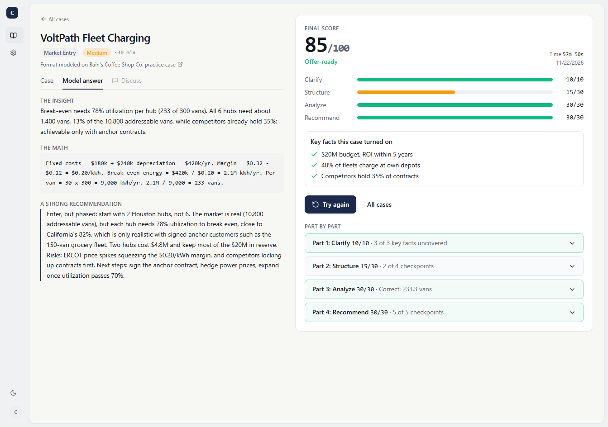

# Casebook

**LeetCode for case interviews.** Practice consulting, finance and PM case interviews in the real interview format.
You work a business case one part at a time, and every part is graded against hidden checkpoints.

**Live:** https://casebook.app.space · Built on [DeepSpace](https://docs.deep.space)


## How a case works

Each case is four parts worth 100 points, played in order, one submission each:

| Part | You | How it's graded | Pts |
| --- | --- | --- | --- |
| 1. Clarify | Ask an AI interviewer up to 3 questions | **Code** counts how many of the case's 3 key facts your questions uncovered | 10 |
| 2. Structure | Lay out your framework / issue tree | **AI judge** marks each hidden checkpoint hit or missed; code turns that into points | 30 |
| 3. Analyze | Read the exhibit (unlocks now), compute one number, say what it means | Number checked **exactly by code** (±2% full, ±10% half); the "so what" by the AI judge | 30 |
| 4. Recommend | Give the CEO a top-down answer | AI judge: the case's "right call" + answer-first, numbers, risks, next steps | 30 |



When you finish you get a scorecard (score band, points per part, which key facts you found or missed), the model
answer, and the per-case **Discuss** tab. Your history is on **Progress**, and best scores go on a public **Leaderboard**.

The three launch cases (profitability, market entry, M&A) are original. They're modeled on published practice-case
formats, and every number is hand-checked so the math can be graded right or wrong. The write-ups are in
[CASES.md](CASES.md).

## How it's built on DeepSpace

| DeepSpace primitive | Used for |
| --- | --- |
| **Auth** (`DeepSpaceAuthProvider`, `AuthOverlay`) | Sign-in with Google, GitHub or email. No auth code written. |
| **Collections + schemas** (`src/schemas/`) | `attempts` (private), `leaderboard` (public), plus the messaging collections |
| **RBAC in the RecordRoom** | `attempts`: members read **their own** and write **nothing**. `leaderboard`: everyone reads, nobody writes. Only server actions write either. |
| **Real-time queries** (`useQuery`) | The stepper, score, unlocked exhibit, facts board and leaderboard all update the instant the server writes. No refresh or polling code. |
| **Server actions** (`src/actions/index.ts`) | The only code that advances a case. Each one checks ownership and part order, then grades. |
| **AI integration proxy** (`createDeepSpaceAI`) | Claude Haiku 5.5 with structured (Zod) output for the interviewer and the judge. No API key in the app; billed to the app owner's credits. |
| **Messaging feature** (`npx deepspace add messaging`) | Per-case Discuss channels with threads and reactions. Messages live in their own `chat:<channelId>` rooms. |
| **Worker-only modules** | Fact sheets, exhibits, answers and model answers (`src/server/cases`) never reach the browser. `npm run check:bundle` fails if they do. |
| **Deploy** (`npx deepspace deploy`) | Frontend, worker and database to `casebook.app.space` |
| **Testing** (`npx deepspace test`, test accounts) | Two-user Playwright specs for privacy and anti-cheat (`tests/casebook.spec.ts`) |

Not used, on purpose:
- **Yjs, presence, canvas:** practice is solo.
- **Background jobs:** each AI call takes a few seconds and fits in a request.
- **Cron and email:** reminders are the next feature, not core.
- **Files, payments, knowledge base:** the cases are fixed and the app is free.

## Security model, in one paragraph

The browser can read only your own attempts and can't write them at all. Every state change (next part, unlocked
exhibit, score) goes through a server action that checks the attempt is yours and is on the right part. Hidden case
data lives in worker-only modules, and the model answer is written onto your attempt only after you finish. The AI
never decides a score directly. It returns structured hits and misses (or which facts it revealed), and code turns
those into points. Candidate text is passed to the model inside tags and treated as data, not instructions. All of
this was checked by hand and is covered by the Playwright specs (see [PROGRESS.md](PROGRESS.md)).

## Cost

Owner-billed AI on the free tier: at most 6 Haiku calls per case and 8 new cases per user per day. A full case
costs well under a cent (measured: 5 calls = $0.0015).

## Run it

```sh
npm install
npx deepspace auth login
npx deepspace dev start          # http://localhost:5173
npm run test:unit                # grading, calculator, case-math tests
npm run check:bundle             # build + fail if hidden case data leaks into the client
npx deepspace test run all       # Playwright, incl. two-user privacy / anti-cheat specs
npx deepspace deploy
```

## More

- [DECISIONS.md](DECISIONS.md): every decision we changed our mind on, and what it cost
- [PROGRESS.md](PROGRESS.md): what each build slice added and how it was verified
- [CASES.md](CASES.md): the three cases, hidden facts, worked math and model answers

## What's next

- More cases. Each one is a public summary in `src/cases/catalog.ts` plus a hidden write-up in
  `src/server/cases/index.ts`; the bundle check and case-math unit test guard both.
- An AI interviewer that asks follow-up questions during Part 2, not just Part 1.
- Weekly "cases you haven't tried" email via the cron room and the email integration.
